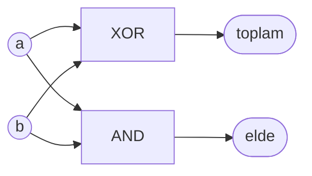

# 00-03 İkili Aritmetik ve Boole Mantığı (Binary Arithmetic and Boolean Logic)

> Önkoşullar: 00-02 | Tahmini süre: ~2 saat | CCNA: v1.1 1.6 (altyapı), 5.6 (joker maske)

## Öğrenme Hedefleri

- İkili toplama yapmak; sabit genişlikteki taşmayı (overflow) açıklamak.
- İkiye tümleyen (two's complement) ve birler tümleyeni (one's complement) gösterimini tanımak.
- AND, OR, NOT, XOR ve NAND işlemlerinin doğruluk tablolarını kurmak.
- Bit düzeyi işlemlerle bir IP adresinin ağ ve yayın adresini hesaplamak.
- Mantık kapılarıyla toplama yapılabildiğini bir yarım toplayıcı (half adder) üzerinden göstermek.

## 1. Sezgisel Giriş

Bir kapıdan geçmek için iki şartın olduğunu düşün: kartını okutman **ve** doğru şifreyi girmen gerekiyor. İkisinden biri eksikse kapı açılmaz. Başka bir kapı, kartın **veya** şifren yeterliyse açılıyor. Bu iki kural, Boole mantığının iki temel işlemidir: AND ve OR.

Bir router, gelen bir paketin hedef adresini alt ağ maskesiyle bit bit **AND**'lediğinde tam olarak bu türden binlerce küçük kararı aynı anda verir. Bu dosyanın sonunda o işlemi elle yapabileceksin.

## 2. Neden Var?

George Boole 19. yüzyılda mantığı cebirsel bir sisteme dönüştürdü: Önermeler yalnızca **doğru (1)** ya da **yanlış (0)** olabilir ve işlemlerle birleştirilir. Claude Shannon 1937'de bu cebirin röle devreleriyle birebir gerçeklenebileceğini gösterdi. O günden beri her dijital devre ve dolayısıyla her ağ cihazı Boole mantığıyla çalışır.

Ağ mühendisi için bu dosyanın üç doğrudan kullanımı vardır:

1. **Adresleme:** Ağ adresi, yayın adresi ve joker maske hesapları bit düzeyi işlemlerdir.
2. **Hata tespiti:** Parite ve CRC, XOR işlemine dayanır.
3. **Sayaçlar ve sıra numaraları:** Sabit genişlikteki sayıların taşması, TCP sıra numaralarının nasıl "başa döndüğünü" açıklar.

## 3. Mekanizma

### 3.1 İkili toplama

Kurallar onluk toplamayla aynıdır; yalnızca 1 + 1 = 10₂ (yani "0 yaz, 1 elde") olur.

| a | b | toplam | elde (carry) |
|---|---|---|---|
| 0 | 0 | 0 | 0 |
| 0 | 1 | 1 | 0 |
| 1 | 0 | 1 | 0 |
| 1 | 1 | 0 | 1 |

Örnek: 01101011 (107) + 00110110 (54)

```
  elde:   111111
          01101011    (107)
        + 00110110    ( 54)
        ----------
          10100001    (161)
```

Kontrol: 128 + 32 + 1 = 161 ✓

### 3.2 Sabit genişlik ve taşma

Donanımda sayılar sabit sayıda bitle tutulur. 8 bitlik bir sayıcı en fazla 255 tutar. 255 + 1 işleminin sonucu 9 bit gerektirir (100000000₂). 9. bitin yeri olmadığı için sayı **0'a döner** ve bir taşma (overflow, wraparound) oluşur.

Bu davranış ağlarda gerçek bir konudur:

- TCP sıra numaraları 32 bittir. Yeterince veri gönderildiğinde 2³² − 1'den 0'a döner. TCP bu yüzden sıra numaralarını karşılaştırırken modüler aritmetik kullanır [RFC 9293] (04-04).
- Arayüz sayaçları da sınırlıdır. Çok hızlı bağlantılarda 32 bitlik bir bayt sayacı kısa sürede başa döner; bu yüzden izleme sistemleri 64 bitlik sayaçları tercih eder (07-09).

### 3.3 Negatif sayılar: ikiye tümleyen

İşlemciler negatif tamsayıları çoğunlukla **ikiye tümleyen (two's complement)** gösterimle tutar: Bir sayının negatifini bulmak için bitlerini tersine çevir ve 1 ekle.

```
 +5 = 00000101
 tersine çevir: 11111010
 1 ekle:        11111011 = −5
```

Bu gösterimin güzelliği şudur: Çıkarma, toplamaya dönüşür. 7 + (−5) = 00000111 + 11111011 = 1 00000010. Taşan 9. bit atılır, sonuç 00000010 = 2 olur. 8 bitle ikiye tümleyen aralığı −128 … +127'dir.

> **[TCP/IP-GERÇEK]** Ağ protokollerinin başlık alanlarının neredeyse tamamı **işaretsiz (unsigned)** sayıdır: Port numarası 0–65535, TTL 0–255. Ağda daha çok karşına çıkacak olan **birler tümleyeni (one's complement)** toplamıdır: IPv4, TCP ve UDP checksum'ları 16 bitlik birler tümleyeni toplamıyla hesaplanır [RFC 1071]. Bu toplamda taşan bit atılmaz, sonuca geri eklenir (end-around carry). Hesaplama yöntemi 03-02'de.

### 3.4 Boole işlemleri

| a | b | a AND b | a OR b | a XOR b | NOT a | a NAND b |
|---|---|---|---|---|---|---|
| 0 | 0 | 0 | 0 | 0 | 1 | 1 |
| 0 | 1 | 0 | 1 | 1 | 1 | 1 |
| 1 | 0 | 0 | 1 | 1 | 0 | 1 |
| 1 | 1 | 1 | 1 | 0 | 0 | 0 |

Her birini bir cümleyle hatırla:

- **AND:** İkisi de 1 ise 1. ("İkisi birden")
- **OR:** En az biri 1 ise 1. ("Herhangi biri")
- **XOR (dışlayıcı veya):** Yalnızca biri 1 ise 1; başka bir deyişle **iki bit farklıysa** 1. ("Fark var mı?")
- **NOT:** Tersine çevirir.
- **NAND:** AND'in tersi. Tek başına NAND kapılarıyla her mantık işlemi kurulabilir; bu yüzden NAND'a evrensel kapı denir.

> **[DERİN]** De Morgan yasaları: NOT(a AND b) = (NOT a) OR (NOT b) ve NOT(a OR b) = (NOT a) AND (NOT b). Devre tasarımında bir ifadeyi daha az kapıyla kurmak için kullanılır.

### 3.5 Bit düzeyi işlemler (bitwise operations)

Bilgisayarda bu işlemler bir baytın ya da kelimenin **her bit konumuna ayrı ayrı ve aynı anda** uygulanır. Her işlemin pratikteki rolü farklıdır:

| İşlem | Pratik rolü | Örnek (8 bit) |
|---|---|---|
| `x AND maske` | **Seç:** Maskede 1 olan bitleri korur, diğerlerini sıfırlar | 10110110 AND 11110000 = 10110000 |
| `x OR maske` | **Ayarla:** Maskede 1 olan bitleri 1 yapar | 10110110 OR 00001111 = 10111111 |
| `x XOR maske` | **Çevir:** Maskede 1 olan bitleri tersine çevirir | 10110110 XOR 11111111 = 01001001 |
| `NOT x` | Tüm bitleri tersine çevirir | NOT 11110000 = 00001111 |
| `x << n` | Sola kaydır: 2ⁿ ile çarp | 00000011 << 2 = 00001100 (3 → 12) |
| `x >> n` | Sağa kaydır: 2ⁿ'e böl (tam bölme) | 00001100 >> 2 = 00000011 |

## 4. Teknik Ayrıntı: Ağdaki üç köprü

### 4.1 AND → ağ adresi

Bir IPv4 adresi ile maskesinin AND'i **ağ adresini (network address)** verir. Maskedeki 1'ler "ağ kısmı", 0'lar "host kısmı" demektir. AND, ağ kısmını korur ve host kısmını sıfırlar.

Örnek: **192.168.10.77/26**. /26, maskenin ilk 26 bitinin 1 olduğu anlamına gelir: 255.255.255.192. İlk üç bayt 255 olduğu için (hepsi 1) sonuç değişmez. İşi dördüncü bayt yapar:

```
  77  = 01001101
  192 = 11000000   (maske)
  AND = 01000000 = 64
```

Ağ adresi: **192.168.10.64**

### 4.2 NOT → joker maske

Maskenin tersine **joker maske (wildcard mask)** denir. Cisco, ACL'lerde ve OSPF'nin `network` komutunda joker maske kullanır. Joker maskede 1, "bu biti kontrol etme" anlamına gelir.

```
  maske   = 11111111.11111111.11111111.11000000   255.255.255.192
  NOT     = 00000000.00000000.00000000.00111111   0.0.0.63
```

Kısa yol: Her bayt için 255 − maske baytı. 255 − 192 = 63.

### 4.3 OR → yayın adresi

Bir alt ağın **yayın adresi (broadcast address)**, host kısmının tamamı 1 olan adrestir. Bunu bulmak için adresi joker maskeyle OR'la:

```
  77  = 01001101
  63  = 00111111   (joker maske)
  OR  = 01111111 = 127
```

Yayın adresi: **192.168.10.127**. Dolayısıyla bu alt ağın host aralığı 192.168.10.65 – 192.168.10.126'dır. Ayrıntılı yöntem 03-04'te.

### 4.4 XOR → parite ve CRC

XOR, iki bitin farklı olup olmadığını söyler. Bir bit dizisindeki tüm bitlerin XOR'u, 1'lerin sayısının tek mi çift mi olduğunu verir. Buna **parite (parity)** denir:

```
  1 XOR 0 XOR 1 XOR 1 XOR 0 XOR 0 XOR 1 XOR 0 = 0   (dört tane 1 var: çift)
```

Gönderici bir **parite biti** eklerse ve iletim sırasında tek bir bit bozulursa, alıcının hesapladığı parite değişir ve hata fark edilir. İki bit birden bozulursa parite değişmez ve hata **fark edilmez**. Ethernet'in kullandığı **CRC (Cyclic Redundancy Check)** bu zayıflığı gidermek için çok daha güçlü bir yöntem kullanır: polinom bölmesi. Bu bölmede çıkarma işlemi XOR'dur (02-04).

### 4.5 Mantık kapılarıyla toplama: yarım toplayıcı

Bölüm 3.1'deki toplama tablosuna tekrar bak:

- "toplam" sütunu tam olarak **a XOR b**'dir.
- "elde" sütunu tam olarak **a AND b**'dir.

Yani bir XOR kapısı ve bir AND kapısı, iki biti toplayan bir devre oluşturur. Buna **yarım toplayıcı (half adder)** denir:



*Ne görüyoruz:* İki giriş bitinin her biri iki kapıya birden girer. XOR kapısı toplam bitini, AND kapısı elde bitini üretir.

Önceki basamaktan gelen eldeyi de hesaba katan devreye **tam toplayıcı (full adder)** denir. 32 tam toplayıcı yan yana konduğunda 32 bitlik sayıları toplayan bir devre elde edilir. Bir router'ın TTL'yi azaltması ya da checksum hesaplaması, sonunda bu tür kapılarla yapılır. Kapıların transistörlerle nasıl kurulduğu 00-05'te.

## 5. Gerçek Dünya Örnekleri

- **Ev ağın:** Bilgisayarın 192.168.1.10/24 adresine sahip ve 192.168.1.50'deki yazıcıya baskı gönderiyor. İşletim sistemi iki adresi de 255.255.255.0 ile AND'ler. İkisinde de sonuç 192.168.1.0 olduğu için yazıcının yerel ağda olduğuna karar verir ve paketi doğrudan yazıcıya gönderir. 8.8.8.8 için sonuç 8.8.8.0 çıkar; bu yüzden paket router'a gider. (Bu kararı router değil, **bilgisayarın kendisi** verir; 03-06.)
- **Veri merkezi:** Bir router'ın yönlendirme tablosunda yüz binlerce rota olabilir. Her paket için "bu hedef, hangi rotanın önekine uyuyor?" sorusu bir AND ve karşılaştırma işlemidir. Yüksek hızlı router'lar bu aramayı özel donanımda (TCAM) tek bir adımda yapar (03-07).
- **Cisco ACL:** `access-list 10 permit 192.168.10.64 0.0.0.63` satırı, joker maskesi sayesinde 192.168.10.64–127 aralığındaki tüm kaynak adreslerini eşleştirir (14-03).

## 6. Diğer Konularla Bağlantı

| Bu dosyadaki fikir | Nerede kullanılıyor |
|---|---|
| AND ile ağ adresi | 03-04, 03-06, 03-08 |
| Joker maske | 03-15 (OSPF), 14-03 (ACL) |
| XOR, parite, CRC | 02-04 |
| Birler tümleyeni checksum'ı | 03-02, 04-02 |
| Taşma ve modüler aritmetik | 04-04 (TCP sıra numaraları) |
| Mantık kapıları | 00-05 |

## 7. Cisco ve Pratik

Joker maskeyi iki yaygın Cisco komutunda göreceksin (ayrıntılar ilgili dosyalarda):

```
Router(config)# access-list 10 permit 192.168.10.64 0.0.0.63
Router(config)# router ospf 1
Router(config-router)# network 10.1.1.0 0.0.0.255 area 0
```

Hesaplarını Python ile kontrol edebilirsin:

```python
ip, mask = 77, 192
ip & mask          # 64   → ağ adresinin son baytı
ip | (255 - mask)  # 127  → yayın adresinin son baytı
255 - mask         # 63   → joker maskenin son baytı

import ipaddress
net = ipaddress.ip_interface('192.168.10.77/26').network
net.network_address, net.broadcast_address   # 192.168.10.64, 192.168.10.127
```

## 8. Yaygın Yanılgılar

| Yanılgı | Doğrusu |
|---|---|
| "XOR ile OR aynıdır." | İki bit de 1 olduğunda OR 1 verir, XOR 0 verir. XOR "farklı mı?" sorusunu cevaplar. |
| "Hedefin yerel olup olmadığına router karar verir." | Bu kararı **gönderen host** kendi maskesiyle verir. Router ise yönlendirme tablosuna bakar. (Mevcut notlarındaki §15.2'nin düzeltmesi; CURRICULUM.md, Bölüm 11.2.) |
| "Joker maske her zaman maskenin tersidir." | Çoğu durumda öyledir. Ama ACL'lerde joker maskenin 1'leri ardışık olmak zorunda değildir; örneğin yalnızca tek sayılı adresleri eşleştiren bir joker maske yazılabilir (14-03). |
| "Parite her hatayı yakalar." | Parite, çift sayıda bit hatasını yakalayamaz. Bu yüzden Ethernet CRC kullanır. |
| "Sayaçlar sonsuza kadar artar." | Sabit genişlikteki her sayaç bir gün başa döner. 32 bitlik bayt sayacı 10 Gbps'de yaklaşık 3,4 saniyede dolar. |

## 9. Arıza Giderme Yaklaşımı

Adresleme arızalarının önemli bir kısmı, bir host'un AND işleminin "yanlış" sonuç vermesinden kaynaklanır. Yanlış olan işlem değil, girdidir: yanlış maske ya da yanlış adres. Bir host'un neden bir hedefe ulaşamadığını incelerken:

1. Host'un adresini ve maskesini al (`ipconfig` / `ip addr`).
2. Kendi adresini ve hedef adresi aynı maskeyle AND'le.
3. Sonuçlar aynıysa host hedefi yerel sanıyordur ve ARP ile doğrudan hedefi arar. Farklıysa gateway'e gönderir.
4. Bu kararın ağın gerçek yapısıyla uyuşup uyuşmadığını kontrol et.

Bu yöntem 03-06 ve 11-03'te gerçek arızalar üzerinde kullanılacak.

## 10. CCNA Bağlantısı

- **v1.1 1.6 (IPv4 adresleme ve subnetting):** Ağ adresi, yayın adresi ve host aralığı soruları doğrudan bu dosyadaki AND/OR işlemlerine dayanır.
- **v1.1 5.6 (ACL):** Joker maske hesabı sınavda sık sorulur.
- **v1.1 3.4 (OSPFv2):** `network` komutundaki joker maske.

## 11. Kendini Kontrol Et

1. 10110110 + 01011011 işlemini 8 bitle yap. Taşma oluşur mu?
   <details><summary>Cevap</summary>
   182 + 91 = 273. 273 &gt; 255 olduğu için taşma oluşur. 9 bitlik sonuç 100010001₂; 8 bit tutulursa 00010001 = 17 kalır (273 − 256).
   </details>

2. 172.16.45.200/27 adresinin ağ adresini ve yayın adresini AND/OR ile bul.
   <details><summary>Cevap</summary>
   /27 → son bayt maskesi 224 (11100000), joker 31 (00011111). 200 = 11001000. AND: 11000000 = 192 → ağ adresi <b>172.16.45.192</b>. OR: 11011111 = 223 → yayın adresi <b>172.16.45.223</b>.
   </details>

3. 255.255.240.0 maskesinin joker maskesi nedir?
   <details><summary>Cevap</summary>
   Her bayt için 255 − değer: <b>0.0.15.255</b>.
   </details>

4. Bir bit dizisinde iki bit birden bozulursa parite neden hatayı fark etmez?
   <details><summary>Cevap</summary>
   Parite yalnızca 1'lerin sayısının tek mi çift mi olduğuna bakar. İki bit tersine döndüğünde 1'lerin sayısı ya 2 artar, ya 2 azalır, ya da değişmez; her durumda tekliği/çiftliği aynı kalır.
   </details>

5. Yarım toplayıcıda neden XOR ve AND kapıları kullanılır?
   <details><summary>Cevap</summary>
   İki bitin toplamının "toplam" biti, bitler farklıyken 1'dir; bu XOR'dur. "Elde" biti yalnızca iki bit de 1 olduğunda 1'dir; bu AND'dir.
   </details>

## 12. Uygulama

Bu dosyanın PT pratiği yoktur. Kâğıt üzerinde şu alıştırmayı yap: Aşağıdaki her adres için ağ adresini, joker maskeyi ve yayın adresini **ikili düzeyde** hesapla. Sonra Bölüm 7'deki Python kodu ile kontrol et.

- 10.0.5.130/25
- 192.168.100.37/29
- 172.31.200.1/20

## 13. Ustalık Kontrol Listesi

- [ ] AND, OR, XOR, NOT ve NAND doğruluk tablolarını ezbere yazabiliyorum.
- [ ] Bit düzeyi AND/OR ile bir adresin ağ ve yayın adresini hesaplayabiliyorum.
- [ ] Bir maskeden joker maskeyi hesaplayabiliyorum.
- [ ] Taşmanın ağdaki iki sonucunu (TCP sıra numaraları ve sayaçlar) açıklayabiliyorum.
- [ ] Yarım toplayıcının neden XOR ve AND'den oluştuğunu anlatabiliyorum.

## Kaynaklar

- [RFC 1071] İnternet checksum'ının hesaplanması (birler tümleyeni toplamı).
- [RFC 9293] TCP sıra numaralarının modüler karşılaştırılması.
- [TXT-HARRIS] Digital Design and Computer Architecture: Boole cebiri ve toplayıcı devreler ([DERİN] ek okuma).
- [TXT-PETZOLD] Code, 2. baskı: mantık kapıları ve toplayıcılar (ek okuma).
