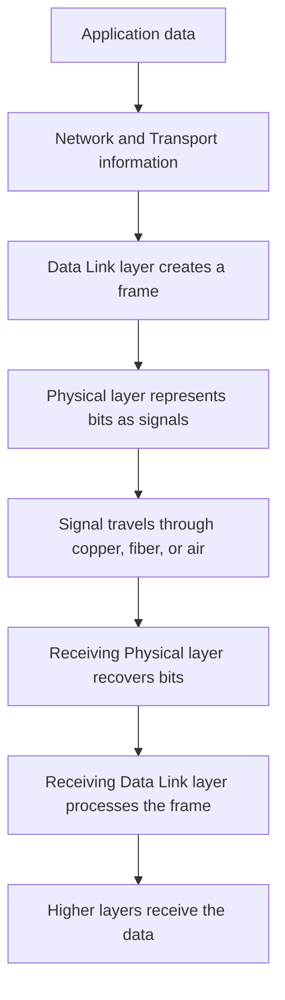

# 01-01 — The Purpose of the Physical Layer

> **Prerequisite:** 00-09 — Layered Models: OSI and TCP/IP  
> **CCNA 200-301 v1.1 connection:** This lesson builds the foundation for physical media, Ethernet interfaces, and link troubleshooting.  
> **Suggested study time:** Flexible.

## What You Will Learn

- Explain the job and limits of the Physical layer.
- Follow data from a frame to the signal that travels through a medium.
- Distinguish the MAC and PHY functions.
- Recognize the main things defined by a physical-layer technology.

## 1. Why Do We Need a Physical Layer?

A network device cannot send a digital file through a cable simply by wishing it to travel. The information must be represented as something that can physically move from one device to another.

Depending on the technology, information may travel as:

- Electrical changes over copper cable.
- Light through fiber-optic cable.
- Radio waves through the air.

The **Physical layer** (OSI Layer 1, or L1) is responsible for sending and receiving the signals that carry bits across a physical medium.

A **medium** is the material or space through which a signal travels. Copper, optical fiber, and air are examples.

The Physical layer focuses on the signal and the connection. It does not decide which application should receive the data or which IP network is the destination.

## 2. What Does the Physical Layer Define?

A physical-layer technology specifies details such as:

| Area | What it describes | Simple example |
|---|---|---|
| Medium | What carries the signal | Copper, fiber, or radio |
| Signal characteristics | What physical changes represent information | Voltage levels, light, or radio waves |
| Connectors and pin layout | How the medium connects to equipment | An Ethernet copper connector |
| Data rate | How quickly bits are sent | 100 Mbps or 1 Gbps |
| Timing and synchronization | How sender and receiver coordinate when to read signals | Recovering timing from a received signal |

A **data rate** is the number of bits transmitted per second. It is usually written as bits per second (bps), such as Mbps or Gbps.

You will study signal characteristics, timing, and different physical media in the next lessons. For now, remember the overall responsibility: Layer 1 moves bits as physical signals.

## 3. From an Application to a Signal

Let's follow a simple example. Your computer sends data to another computer over an Ethernet connection.

1. An application creates data, such as a web request.
2. The network stack adds the information required by the relevant protocols.
3. The Data Link layer organizes the data into an Ethernet **frame**.
4. The Physical layer takes the bit stream and represents it as signals.
5. The signal travels through the cable or other medium.
6. The receiving Physical layer detects the signal and recovers the bit stream.
7. The receiving device passes the data upward so the other layers can process it.

A **frame** is the data unit used by the Data Link layer (OSI Layer 2). It contains control information used for delivery over a local link.

A **bit stream** is an ordered sequence of bits, such as `10110010...`.

Simplified view:

The key boundary is this:

- Layer 2 works with frames and local-link delivery information.
- Layer 1 carries the bits using physical signals.

## 4. What the Physical Layer Does Not Do

The Physical layer does **not**:

- Choose a route between IP networks.
- Read an IP address to decide where a packet should go.
- Use a MAC address to choose the destination of a frame.
- Understand HTTP requests or application data.

Those tasks belong to higher layers.

A cable can successfully carry a signal even when the IP address is wrong. In that situation, the Physical layer may be working correctly while a higher layer is misconfigured.

This is an important troubleshooting idea: a working physical link does not prove that the entire network connection is working.

## 5. MAC and PHY: Two Different Functions

Ethernet equipment commonly separates two functions:

**MAC (Media Access Control):** A function within the Data Link layer. It handles Ethernet frame-related tasks, including MAC addressing and rules for sending frames on the link.

**PHY (Physical Layer transceiver):** The function that sends and receives the physical signal. A transceiver is a component that can transmit and receive signals.

Think of it this way:

- The MAC prepares and handles the Ethernet data.
- The PHY converts the bit stream into the form of signal required by the medium and recovers bits at the other end.

Inside network equipment, a MAC and a PHY communicate over an internal interface. One family of such interfaces is called **MII** (Media Independent Interface). It is an internal connection between MAC and PHY functions, not the Ethernet socket where you plug in a cable. You do not need to memorize MII variants for this lesson.

## 6. Real-World Example: Link Light Is On, but There Is No Internet

Imagine your laptop is connected to a switch. The Ethernet link light is on, but you cannot open a website.

The link light is evidence that the physical connection has established some form of link. It does not prove that:

- Your IP address is correct.
- Your default gateway is reachable.
- DNS is working.
- The remote website is available.

A sensible troubleshooting sequence is to check the physical connection first, then continue through the higher layers.

A **default gateway** is the router or Layer 3 device that a host uses to reach destinations outside its local IP network. **DNS** (Domain Name System) translates names such as `example.com` into IP addresses.

## 7. Common Mistakes

| Mistake | Correct idea |
|---|---|
| The Physical layer sends frames. | The Data Link layer creates frames; the Physical layer carries the bits as signals. |
| The Physical layer understands IP addresses. | IP addressing belongs to the Network layer. |
| The Physical layer always uses electrical signals. | Copper uses electrical signals, fiber uses light, and wireless uses radio waves. |
| A link light means the Internet is working. | It only provides evidence about the local physical link. Higher layers may still have problems. |
| PHY and MAC mean the same thing. | MAC handles Data Link functions; PHY handles physical signaling. |

## 8. Knowledge Check

1. Which OSI layer carries bits using physical signals?
   

Answer
Layer 1 — the Physical layer.

2. Name three possible signal media or forms used in networking.
   

Answer
Electrical signals over copper, light over fiber, and radio waves over the air.

3. Which layer creates an Ethernet frame?
   

Answer
Layer 2 — the Data Link layer.

4. Does the Physical layer choose a route based on an IP address?
   

Answer
No. Routing is a Layer 3 function.

5. What is the main difference between MAC and PHY?
   

Answer
MAC handles Ethernet frame and link-access functions. PHY sends and receives the physical signals that carry the bits.

6. Does an Ethernet link light prove that DNS and the Internet are working?
   

Answer
No. It gives information about the local link, not the operation of higher-layer services.

## 9. Practice

Look at an Ethernet connection on a computer or switch.

1. Identify the cable or wireless medium.
2. Find the link indicator, if one is available.
3. Disconnect the cable and observe what changes.
4. Reconnect it and wait for the link to return.
5. Explain what this test tells you—and what it does not tell you—about the network.

No Packet Tracer lab is required for this introductory lesson.

## 10. CCNA Takeaways

- The Physical layer is OSI Layer 1.
- It carries bits as electrical, optical, or radio signals.
- It defines physical details such as media, connectors, signaling, data rates, and timing.
- The Data Link layer creates and processes frames.
- MAC and PHY are different functions.
- A working physical link does not guarantee working IP connectivity or applications.

## Self-Check

- [ ] I can explain the purpose of the Physical layer in my own words.
- [ ] I can describe the path from a frame to a signal and back to bits.
- [ ] I can distinguish MAC from PHY.
- [ ] I understand why a link light does not prove that the Internet is working.

**Next lesson:** 01-02 — Signals and Bandwidth.
