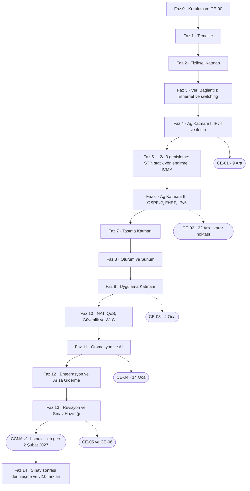
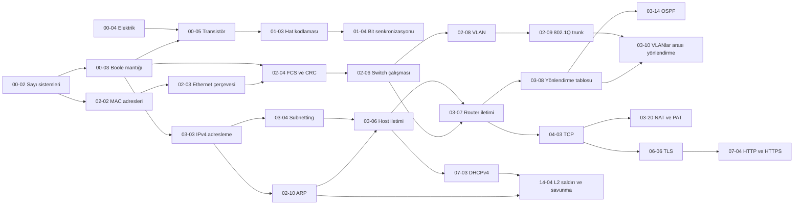

# Study Roadmap and Topic Dependencies

> This file is retained as a reference for topic order and prerequisites. The dated calendar, daily study hours, and session targets in the older v0.2 plan are historical and are **not active study instructions**. Follow START-HERE.md and PROGRESS.md instead. The curriculum target remains CCNA 200-301 v1.1, and English is the study language.

## 1. Overview of the curriculum sequence

- **Hedef:** CCNA 200-301 **v1.1**. Son sınav günü **2 Şubat 2027 (Salı)**.
- **Study pace:** Flexible and based on availability. There are no required daily hours, study days, or fixed review sessions.
- **Sequence:** The original plan groups topics into phases. Treat this as a topic-order reference, not a time commitment or calendar.
- **Progress:** Move forward when the current concepts are understood. Do not rush to meet a date.
- **Exam target:** CCNA 200-301 v1.1. The syllabus version is fixed unless the user explicitly changes it.
- **Optional extensions:** Advanced sections and extra labs are secondary to the v1.1 exam objectives.
- **Her faz** teori, pratik (yönerge veya tam lab), soru ve bir **ustalık kapısı** içerir. Kapı geçilmeden sonraki faza geçilmez.

*Ne görüyoruz:* Fazlar sırayla ilerler. Kesikli oklar kümülatif kapsamlı sınavları ve hedef tarihlerini gösterir. CE-02, sınav sürümüne son kez karar verilen noktadır (Bölüm 8).

## 2. Kritik önkoşul zinciri

Aşağıdaki diyagram, faz sırasını belirleyen en önemli konu bağımlılıklarını gösterir. Dosya düzeyindeki tüm önkoşullar CURRICULUM.md'deki "Önkoşul" sütunundadır.

*Ne görüyoruz:* Subnetting'in kökü Boole mantığındaki AND işlemidir. ARP, hem host'un hem router'ın iletim kararının ön şartıdır. NAT/PAT ve TLS, TCP'den önce anlaşılamaz. L2 güvenlik savunmaları DHCP ve ARP bilinmeden anlamsız kalır.

## 3. Historical calendar (not an active study schedule)

The table below is retained only as a historical record of the earlier v0.2 plan. **Do not follow its dates or estimated hours.** Study at a flexible pace. Use the curriculum order and record actual lesson progress in PROGRESS.md.

| Faz | Konu | Hedef tarih | Saat | Teori | PT pratikleri | Host | Senaryo | Sınav |
|---|---|---|---|---|---|---|---|---|
| 0 | Kurulum ve tanı | 20 Kas | ~4 | 12-01 | — | — | — | CE-00 |
| 1 | Temeller | 20–25 Kas | ~16 | 00-01 – 00-09 | — | — | — | — |
| 2 | Fiziksel Katman | 25–28 Kas | ~16 | 11-01, 01-01 – 01-10 | LAB-001 – LAB-011 | H04 | — | — |
| 3 | Veri Bağlantı I | 28 Kas – 3 Ara | ~20 | 02-01 – 02-09, 02-14 | LAB-012 – LAB-020 | H02 | — | — |
| 4 | Ağ Katmanı I | 3–9 Ara | ~24 | 03-01 – 03-08, 02-10, 11-03 | LAB-021 – LAB-025 | H01 | 08-01, 08-03 | CE-01 |
| 5 | L2/L3 genişleme | 9–17 Ara | ~30 | 02-11 – 02-13, 02-15, 02-16, 03-09 – 03-12, 11-02 | LAB-026 – LAB-039 | H06 | 08-04 | — |
| 6 | Ağ Katmanı II | 17–22 Ara | ~20 | 03-13 – 03-19 | LAB-040 – LAB-047, LAB-049 | H03 | — | CE-02 |
| 7 | Taşıma Katmanı | 22–25 Ara | ~14 | 04-01 – 04-07 | LAB-050 – LAB-051 | H07 | 08-02, 08-07 | — |
| 8 | Oturum ve Sunum | 25–28 Ara | ~9 | 05-01 – 05-02, 06-01 – 06-06 | — | — | — | — |
| 9 | Uygulama Katmanı | 28 Ara – 4 Oca | ~22 | 07-01 – 07-11 | LAB-052 – LAB-061 | H11 – H13 | 08-05, 08-06 | CE-03 |
| 10 | NAT, QoS, Güvenlik, WLC | 4–11 Oca | ~28 | 03-20, 03-21, 14-01 – 14-06 | LAB-062 – LAB-068, LAB-070 – LAB-073 | — | 08-08 | — |
| 11 | Otomasyon ve AI | 11–14 Oca | ~12 | 15-01 – 15-06 | LAB-074 | — | — | CE-04 |
| 12 | Entegrasyon ve Arıza Giderme | 14–19 Oca | ~22 | 11-04, 11-05 | LAB-075 – LAB-090 | — | 08-09, 08-10 | — |
| 13 | Revizyon ve Sınav | 19–26 Oca | ~26 | 13-01 – 13-04 | LAB-091 – LAB-100 | — | — | CE-05, CE-06 |
| — | Tampon | 27 Oca – 1 Şub | — | — | — | — | — | — |
| 14 | Sınav sonrası | sınavdan sonra | ~60 | `[DERİN]` bölümler | LAB-048, LAB-069 | H05, H08 – H10, H14 – H19, K01 – K08 | — | — |

Her fazın soru çalışması, o fazın konularına ait `Q-` dosyalarıdır (bkz. CURRICULUM.md, Bölüm 6).

## 4. Faz ayrıntıları

Her fazda **Sıra** satırı önerilen çalışma sırasını, **Ustalık kapısı** ise sonraki faza geçmeden önce karşılanması gereken ölçülebilir ölçütleri gösterir. Pratikler numara sırasıyla teorinin arasına yerleştirildi. Teori dosyalarındaki `[DERİN]` ve `[v2.0-FARK]` bölümleri sınav öncesi atlanabilir.

### Faz 0 — Kurulum ve tanı (20 Kasım, ~4 saat)

- **Hedef:** Araçları ve çalışma alışkanlığını hazırlamak; mevcut notlarına göre başlangıç düzeyini ölçmek.
- **Sıra:** README.md → 12-01 → CE-00 (önce cevap anahtarına bakmadan çöz, sonra kontrol et) → Packet Tracer 9.0 kontrolü (Windows) → Wireshark kurulumu (Windows ve Fedora) → tekrar kartı sistemi (Anki ya da Markdown) → GitHub deposu.
- **Ustalık kapısı:** PT'de iki PC'yi bağlayıp ping atabilmek; Wireshark'ta bir yakalama başlatıp durdurabilmek. CE-00'ın amacı geçmek değil, eksikleri görmektir. Yanlış cevaplanan sorular, ilgili fazdaki dosyalara işaretlenir.

### Faz 1 — Temeller (20–25 Kasım, ~16 saat)

- **Hedef:** Bir bitin ne olduğunu, nasıl saklandığını ve verinin bitlerle nasıl temsil edildiğini anlamak; ağın ve katmanlı modelin genel çerçevesini kurmak.
- **Sıra:** 00-01 → 00-02 → 00-03 → 00-04 → 00-05 → 00-06 → 00-07 → 00-08 → 00-09
- **Ustalık kapısı:**
  - Herhangi bir 8 bitlik değeri ikili, onluk ve onaltılık arasında 30 saniyede çevirmek (10 denemede 10 doğru).
  - Bir bitin transistörlerle nasıl saklandığını ve neden yalnızca iki seviye kullanıldığını kaynağa bakmadan 3 dakikada anlatmak.
  - OSI ve TCP/IP katmanlarını PDU adlarıyla eşlemek; katmanlı tasarımın iki gerekçesini söylemek.
  - FND sorularında ≥ %85.

### Faz 2 — Fiziksel Katman (25–28 Kasım, ~16 saat)

- **Hedef:** Bitlerin bakır, fiber ve radyo dalgası üzerinde nasıl taşındığını ve alıcının bunları nasıl geri kurduğunu anlamak.
- **Sıra:** 11-01 → LAB-001 → LAB-002 → 01-01 → 01-02 → 01-03 → 01-04 → 01-05 → 01-06 → LAB-003 → LAB-004 → LAB-005 → LAB-006 → 01-07 → 01-08 → H04 → 01-09 → LAB-007 → LAB-008 → LAB-009 → LAB-010 → 01-10 → LAB-011
- **Ustalık kapısı:**
  - Bir baytı Manchester ve MLT-3 ile elle kodlamak.
  - "Alıcı bitleri nasıl geri kurar?" sorusunu preamble, saat kurtarma ve karar eşiği kavramlarıyla anlatmak.
  - Bükümlü çiftin gürültüyü nasıl bastırdığını ve 100 m sınırının nedenini açıklamak.
  - Verilen bir `show interfaces` çıktısındaki L1 sorununu teşhis etmek.
  - LAB-011'i çözüme bakmadan 30 dakikada tamamlamak; PHY sorularında ≥ %85.

### Faz 3 — Veri Bağlantı Katmanı I: Ethernet ve switching (28 Kasım – 3 Aralık, ~20 saat)

- **Hedef:** Çerçevenin yapısını, hata tespitini ve bir switch'in çerçeveyi nasıl ilettiğini anlamak; VLAN ve trunk ile ağı mantıksal olarak bölmek.
- **Sıra:** 02-01 → 02-02 → 02-03 → H02 → LAB-012 → 02-04 → 02-05 → 02-06 → LAB-013 → 02-07 → LAB-014 → 02-08 → LAB-015 → 02-09 → LAB-016 → LAB-017 → LAB-018 → 02-14 → LAB-019 → LAB-020
- **Not:** LAB-014'te switch'e IP adresi verilir. IP adresini bu aşamada 00-08'deki tanımıyla kullan; mekanizması Faz 4'te açıklanacak.
- **Ustalık kapısı:**
  - "Bir çerçeve switch'e girdiğinde ne olur?" sorusunu FCS kontrolünden çıkış portuna kadar hatasız anlatmak.
  - Verilen bir çerçeve dizisi için MAC tablosunun her adımdaki durumunu tahmin edip PT'de doğrulamak.
  - 802.1Q etiketinin alanlarını bit düzeyinde çizip açıklamak.
  - LAB-020'yi 30 dakikada tamamlamak; DL sorularının (Faz 3 kısmı) ≥ %85'i.

### Faz 4 — Ağ Katmanı I: IPv4 ve iletim (3–9 Aralık, ~24 saat)

- **Hedef:** IPv4 adreslemeyi ve subnetting'i ikili düzeyde kavramak; host'un ve router'ın iletim kararlarını adım adım izlemek.
- **Sıra:** 03-01 → 03-02 → 03-03 → 02-10 → LAB-021 → 03-04 → 03-05 → 03-06 → 11-03 → H01 → LAB-022 → 03-07 → LAB-023 → 03-08 → LAB-024 → LAB-025 → 08-01 → 08-03 → CE-01
- **Ustalık kapısı:**
  - /8 ile /30 arasındaki herhangi bir adres için ağ adresini, yayın adresini ve host aralığını 60 saniyede bulmak (10 denemede 10 doğru).
  - Verilen gereksinimlere göre bir VLSM planını 10 dakikada hatasız hazırlamak.
  - İki alt ağ arasındaki bir ping için her atlamadaki kaynak/hedef MAC ve IP değerlerini tablo halinde yazmak.
  - "Router bir IP paketi aldığında ne olur?" sorusunu adım adım anlatmak.
  - CE-01'de ≥ %80.

### Faz 5 — L2/L3 genişleme: STP, EtherChannel, statik yönlendirme, ICMP (9–17 Aralık, ~30 saat)

- **Hedef:** Yedekli L2 tasarımını döngüsüz tutmak; statik yönlendirmeyi ve VLAN'lar arası yönlendirmeyi kurmak; ICMP ve MTU ile yolu teşhis etmek; kablosuz LAN mimarisini tanımak.
- **Sıra:** 02-11 → LAB-026 → 02-12 → LAB-027 → LAB-028 → 02-13 → LAB-029 → LAB-030 → 03-09 → LAB-031 → LAB-032 → LAB-033 → 03-10 → LAB-034 → LAB-035 → 03-11 → 11-02 → LAB-036 → H06 → 03-12 → LAB-037 → LAB-038 → LAB-039 → 02-15 → 02-16 → 08-04
- **Ustalık kapısı:**
  - Verilen bir topolojide root köprüyü, her portun rolünü ve durumunu tahmin edip PT'de doğrulamak.
  - EtherChannel'ın neden oluşmadığını üç farklı uyumsuzluk için açıklamak.
  - Verilen bir yönlendirme tablosu ve hedef adres için LPM ile next-hop seçmek (10 denemede 10 doğru).
  - Traceroute'un TTL ile nasıl çalıştığını anlatmak; Windows ve Linux arasındaki farkı söylemek.
  - LAB-030 ve LAB-039'u her biri 30 dakikada tamamlamak.

### Faz 6 — Ağ Katmanı II: OSPFv2, FHRP, IPv6 (17–22 Aralık, ~20 saat)

- **Hedef:** Dinamik yönlendirmeyi, ilk atlama yedekliliğini ve IPv6'yı (adresleme, NDP, statik yönlendirme) kavramak.
- **Sıra:** 03-13 → 03-14 → 03-15 → LAB-040 → LAB-041 → LAB-042 → LAB-043 → 03-19 → LAB-044 → 03-16 → LAB-045 → 03-17 → H03 → LAB-046 → 03-18 → LAB-047 → LAB-049 → CE-02
- **Ustalık kapısı:**
  - OSPF komşuluğunun kurulmamasının beş nedenini sayıp her biri için doğrulama komutunu söylemek.
  - Verilen öncelik ve router ID değerleriyle DR/BDR seçimini tahmin etmek.
  - IPv6 adreslerini hatasız sıkıştırıp genişletmek; bir MAC adresinden EUI-64 arayüz kimliğini elle hesaplamak.
  - SLAAC ile adres alma sürecini NDP mesajlarıyla anlatmak.
  - CE-02'de ≥ %80. **Karar noktası** (Bölüm 8).

### Faz 7 — Taşıma Katmanı (22–25 Aralık, ~14 saat)

- **Hedef:** İki uygulamanın ağ üzerinden nasıl haberleştiğini; TCP'nin güvenilirliği, akış ve tıkanıklık kontrolünü nasıl sağladığını anlamak.
- **Sıra:** 04-01 → 04-02 → 04-03 → LAB-050 → 04-04 → 04-05 → H07 → 04-06 → LAB-051 → 04-07 → 08-02 → 08-07
- **Ustalık kapısı:**
  - TCP durum makinesini boş kâğıda çizmek.
  - Bir Wireshark yakalamasında yeniden iletimi ve pencere değişimini bulmak.
  - Verilen bant genişliği ve RTT için BDP'yi hesaplayıp pencere boyutuyla ilişkilendirmek.
  - Oyun, video akışı ve dosya indirme için TCP veya UDP seçimini gerekçelendirmek; TRN sorularında ≥ %85.

### Faz 8 — Oturum ve Sunum Katmanları (25–28 Aralık, ~9 saat)

- **Hedef:** OSI teorisi ile TCP/IP gerçeği arasındaki farkı görmek; karakter kodlama, serileştirme, sıkıştırma ve TLS'i bayt düzeyinde anlamak.
- **Sıra:** 05-01 → 05-02 → 06-01 → 06-02 → 06-03 → 06-04 → 06-05 → 06-06
- **Ustalık kapısı:**
  - "ş", "ğ" ve "İ" karakterlerinin UTF-8 baytlarını elle hesaplamak.
  - Bir JSON belgesindeki nesne, dizi ve anahtar-değer çiftlerini ayırt etmek.
  - TLS 1.3 el sıkışmasını mesaj mesaj anlatmak; "TLS hangi katmandadır?" sorusuna nüanslı bir cevap vermek.
  - SES ve PRS sorularında ≥ %85.

### Faz 9 — Uygulama Katmanı (28 Aralık – 4 Ocak, ~22 saat)

- **Hedef:** Ağın temel servislerini (DHCP, DNS, HTTP, dosya aktarımı, uzaktan yönetim, NTP, SNMP, syslog) kurmak, izlemek ve arızalarını gidermek.
- **Sıra:** 07-01 → 07-03 → LAB-052 → LAB-053 → LAB-054 → H12 → 07-02 → LAB-055 → H11 → 07-04 → LAB-056 → 07-06 → 07-07 → LAB-057 → H13 → 07-05 → LAB-058 → LAB-059 → 07-08 → 07-09 → LAB-060 → LAB-061 → 07-10 → 07-11 → 08-05 → 08-06 → CE-03
- **Ustalık kapısı:**
  - DORA'nın her mesajı için kaynak/hedef MAC, IP ve port değerlerini yazmak; relay devreye girdiğinde nelerin değiştiğini göstermek.
  - DNS'in bir web isteğindeki rolünü ve çözümlemenin adımlarını anlatmak.
  - SSH'nin Telnet'ten neden güvenli olduğunu anlatmak; TFTP ile FTP'nin farkını söylemek.
  - Bir syslog mesajını tesis, seviye ve içerik olarak çözümlemek.
  - CE-03'te ≥ %80.

### Faz 10 — NAT, QoS, Güvenlik ve WLC (4–11 Ocak, ~28 saat)

- **Hedef:** Adres çevirisini, trafik önceliklendirmeyi, kablosuz LAN yapılandırmasını ve ağın L2'den L7'ye kadar korunmasını anlamak ve yapılandırmak.
- **Sıra:** 03-20 → LAB-062 → LAB-063 → 03-21 → 14-01 → 14-03 → LAB-064 → LAB-065 → LAB-066 → 14-04 → LAB-067 → LAB-068 → 14-02 → LAB-070 → 14-06 → LAB-071 → 14-05 → LAB-072 → LAB-073 → 08-08
- **Ustalık kapısı:**
  - NAT'ın dört adres terimini (inside local/global, outside local/global) bir örnek üzerinde göstermek.
  - Verilen bir güvenlik politikası için ACL yazıp doğru arayüze ve yöne yerleştirmek.
  - Her L2 saldırısını savunmasıyla eşleyip savunmanın neden işe yaradığını açıklamak.
  - RADIUS ile TACACS+ arasındaki üç farkı söylemek; WLC GUI'de WPA2-PSK bir WLAN oluşturmak.
  - LAB-073'ü 30 dakikada tamamlamak; SEC sorularında ≥ %85.

### Faz 11 — Otomasyon ve AI (11–14 Ocak, ~12 saat)

- **Hedef:** Ağların bugün nasıl tasarlandığını, sanallaştırıldığını ve yönetildiğini anlamak; v1.1'in 6. alanındaki kavramları sınav düzeyinde açıklayabilmek.
- **Sıra:** 15-01 → 15-02 → 15-03 → 15-04 → LAB-074 → 15-05 → 15-06 → CE-04
- **Ustalık kapısı:**
  - Kontrol, veri ve yönetim düzlemlerini hem bir router hem bir SDN kontrolcüsü üzerinde ayırt etmek; overlay, underlay ve fabric kavramlarını bir diyagramda göstermek.
  - Bir REST çağrısını CRUD işlemi ve HTTP fiiliyle eşlemek; bir JSON yanıtını okumak.
  - Ansible ile Terraform'un farkını ve VM, konteyner ve VRF farkını açıklamak.
  - Üretken ve tahmine dayalı AI'ın ağ operasyonlarındaki rolünü birer örnekle anlatmak.
  - CE-04'te ≥ %80.

### Faz 12 — Entegrasyon ve Arıza Giderme (14–19 Ocak, ~22 saat)

- **Hedef:** Bütün katmanları tek bir ağda birleştirmek ve çok hatalı senaryoları sistematik olarak çözmek.
- **Sıra:** 08-09 → LAB-075 → LAB-076 → LAB-077 → LAB-078 → LAB-079 → LAB-080 → LAB-081 → LAB-082 → 08-10 → 11-04 → LAB-083 → LAB-084 → LAB-085 → LAB-086 → LAB-087 → LAB-088 → LAB-089 → LAB-090 → 11-05
- **Ustalık kapısı:**
  - 08-09 senaryosunu boş kâğıda baştan sona, her atlamadaki başlıklarla çizmek.
  - LAB-083 – LAB-090'ı her biri belirtilen süre içinde, çözüme bakmadan tamamlamak.
  - Her arıza için belirti, hipotez, doğrulama komutu ve düzeltme adımlarını yazılı olarak belgelemek.

### Faz 13 — Revizyon ve Sınav Hazırlığı (19–26 Ocak, ~26 saat)

- **Hedef:** Boşlukları kapatmak ve sınav koşullarında performans göstermek.
- **Sıra:** 13-01 → 13-02 → LAB-091 → LAB-092 → LAB-093 → LAB-094 → LAB-095 → CE-05 → 13-03 (zayıf alanlara geri dönüş) → LAB-096 → LAB-097 → LAB-098 → LAB-099 → CE-06 → LAB-100 → 13-04
- **Ustalık kapısı:**
  - CE-05 ve CE-06'da ≥ %85.
  - Capstone lablarını süre sınırı içinde tamamlamak.
  - 13-04'teki kontrol listesinin tamamı.

### Faz 14 — Sınav sonrası derinleşme ve v2.0 farkları (~60 saat)

- **Hedef:** Sınav için atlanan derinliği tamamlamak; v2.0 farklarını ve DevOps/Kubernetes ağlarına köprü konuları çalışmak.
- **Sıra:** Teori dosyalarındaki `[DERİN]` ve `[v2.0-FARK]` bölümleri → LAB-048 → LAB-069 → H05 → H08 → H09 → H10 → H14 → H15 → H16 → H17 → H18 → H19 → K01 → K02 → K03 → K04 → K05 → K06 → K07 → K08
- **Not:** Sınav 2 Şubat'tan sonraya kalırsa (Bölüm 8) bu fazın v2.0 kısmı Faz 13'ten önce yapılır. Hangi dosyaların etkilendiği CURRICULUM.md, Bölüm 9.2'de.
- **Ustalık kapısı:** CURRICULUM.md, Bölüm 9.2'deki her v2.0 konusu için en az bir pratik ve ilgili sorularda ≥ %85.

## 5. Aralıklı tekrar ve kümülatif değerlendirme

- **Kart yazma:** Her teori dosyası bittiğinde 5–15 tekrar kartı yaz (kurallar 12-01'de) ve 12-02'ye ekle.
- **Tekrar aralıkları:** 1 gün → 3 gün → 7 gün → 14 gün → 30 gün. Yanlış cevaplanan kart ilk aralığa döner. Sınava kalan süre kısa olduğu için 60 günlük aralık kullanılmıyor.
- **Pazar tekrarı (~2 saat):** Kart tekrarı; önceki fazlardan rastgele sorular; eski bir pratiği sıfırdan, çözüme bakmadan yeniden yapmak; kapsülleme yığınını ya da bir 08-* senaryosunu boş kâğıda çizip dosyayla karşılaştırmak.
- **Kapsamlı sınavlar (CE-01 – CE-06):** Kümülatif değerlendirmelerdir; soruların yaklaşık %30'u önceki fazlardan gelir. CE-00 bunlardan ayrıdır: yalnızca başlangıç düzeyini ölçen bir tanı testidir.
- **Gecikmeli test:** Bir modül Seviye 5'e, ancak kapıdan en az 14 gün sonra yapılan tekrar testinde ≥ %80 alındığında çıkar. Faz 11 ve sonrası için bu test sınavdan sonra yapılır.

## 6. Ustalık seviyeleri

PROGRESS.md'deki öğrenci takibi bu seviyeleri kullanır. Okumak tek başına ustalık değildir.

| Seviye | Ad | Ölçüt | Karşıladığı ustalık ölçütleri |
|---|---|---|---|
| 0 | Başlanmadı | — | — |
| 1 | Okundu | Dosya okundu ve "Kendini Kontrol Et" soruları cevaplandı | — |
| 2 | Açıklıyor | "Kendini Kontrol Et" soruları ve soru bankasındaki K (kendi cümlelerinle) soruları, kaynağa bakmadan ve nasıl/neden çalıştığını da açıklayarak doğru cevaplandı | (1) kendi cümleleriyle açıklama, (2) nasıl ve neden, (3) iletişimdeki rolü |
| 3 | Uyguluyor | İlgili pratikler çözüme bakmadan tamamlandı; konu sorularında ≥ %85 | (4) pratikte uygulama, (7) teknik sorular |
| 4 | Arıza gideriyor | İlgili break-fix labı ve A kategorisi sorular başarıldı | (5) yaygın hataları tanıma, (6) arıza giderme |
| 5 | Ustalaştı | Faz kapısı geçildi ve ≥ 14 gün sonraki gecikmeli testte ≥ %80 alındı | Yedi ölçütün tamamı, kalıcı olarak |

## 7. Günlük çalışma şablonu

Pazartesi–cumartesi, toplam ~4,75 saat:

| Oturum | Süre | İçerik |
|---|---|---|
| 1 | 1,5 saat | Yeni teori (günün en zinde saati) |
| 2 | 1,5 saat | Teorinin devamı ve "Kendini Kontrol Et" soruları |
| 3 | 1,5 saat | PT pratiği (yönerge ya da tam lab) veya host labı |
| Kart tekrarı | 15 dk | Günü gelen kartlar |
| Ek | 0–1 saat | Soru bankası veya geride kalınan pratik |

Oturumlar arasında en az 15 dakika ara ver. Pazar günü yalnızca Bölüm 5'teki ~2 saatlik tekrar yapılır.

## 8. Karar noktaları

| Ne zaman | Kontrol | Karar |
|---|---|---|
| CE-01 (9 Aralık) | Plandan 3 çalışma gününden fazla geride misin? | Evet → `[DERİN]` bölümleri tamamen atla ve bazı yönergeleri kısalt |
| CE-02 (22 Aralık) | Sınava gireceğin yer ve uygunluk netleşti mi, sınav rezervasyonu yapıldı mı? Plandan 5 çalışma gününden fazla geride misin? | Uygunluk netleşmediyse ya da 5 günden fazla gerideysen → hedefi v2.0'a çevir (3 Şubat sonrası); Faz 14'ün v2.0 kısmı Faz 13'ten önce yapılır |
| CE-04 (14 Ocak) | CE-04 ≥ %80 mi? | Hayır → tampon günleri Faz 12'den önce zayıf alanlara ayır |
| CE-05 (yaklaşık 23 Ocak) | CE-05 ≥ %85 mi? | Hayır → sınavı tampon dönemin sonuna (en geç 2 Şubat) kaydır |
